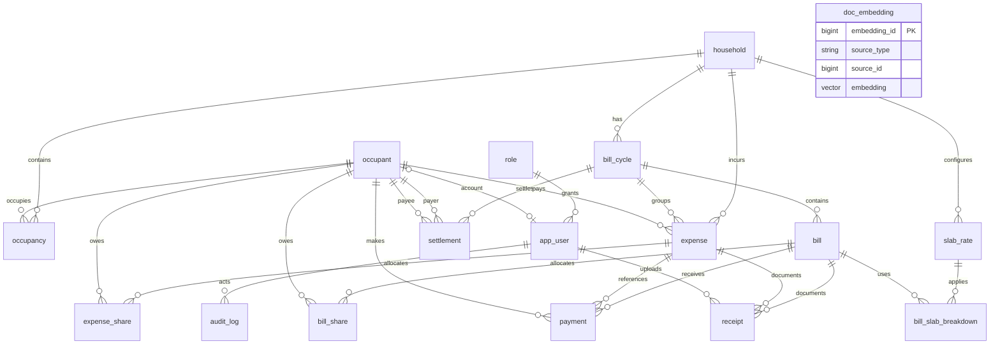
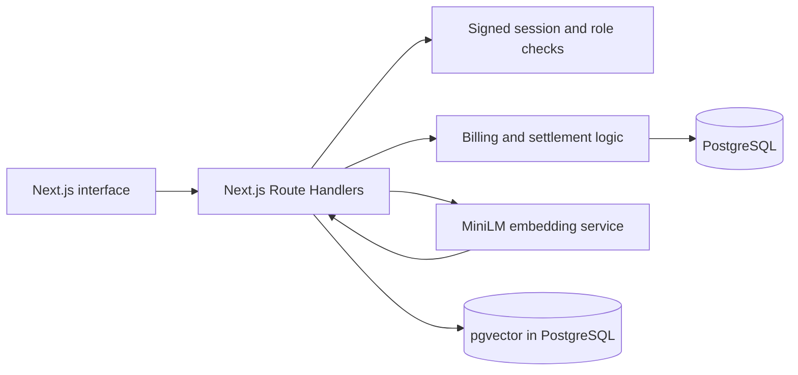

# SlabSplit project documentation

## Problem statement and motivation

Shared flats receive one utility bill even though occupants may join or leave partway through a cycle. Dividing by the number of current flatmates charges people for days they were absent. SlabSplit records actual occupancy periods, calculates tiered utility charges, allocates costs by applicable days, and reduces reimbursements to a small number of transfers.

## Objectives and scope

The base application manages household membership, billing cycles, tariff slabs, utility bills, shared expenses, provider payments, receipts, and internal settlements. It calculates bill slabs and shares, keeps each result in PostgreSQL, and supports full-text and vector search over expense descriptions and receipt text. The base demo handles a single currency, INR. The household table retains a currency field for future use.

## Functional requirements implemented

| Requirement | Implementation |
| --- | --- |
| Household, occupants, dated membership | Household/people forms and occupancy table |
| Tariff and cycle management | Rate and cycle forms with database constraints |
| Slab utility calculation | `calculateSlabs` and `bill_slab_breakdown` |
| Day-weighted bill sharing | `occupancy_days` and `bill_share` |
| Shared expenses and weighted rent | Expense form and `expense_share` |
| Payments and settlements | Bill payments, expense reimbursements, cycle balance view, settlement generation |
| Receipts and search | File upload, receipt text, GIN full-text and pgvector similarity |
| Audit and role-based access | Triggered `audit_log`, admin/member API checks |
| Demonstrable SQL reports | Reports tab with grouped totals, occupancy days, and above-average expenses |

## ER diagram

`doc_embedding` is drawn standalone, with no relationship line, because its source is polymorphic: `(source_type, source_id)` points at an expense or a receipt, so no single foreign key can express it. The application validates that link before indexing. Every other entity here carries real foreign keys, so this diagram and `docs/diagrams/slabsplit_relational.svg` describe the same 17 tables and the same relationships. This diagram adds `bill_share` to the relational model depicted in the original PDF.

## Relational schema and data dictionary

The full SQL DDL in `database/schema.sql` is the executable relational schema. This table summarizes each entity; column types, checks, and key definitions are in that file.

| Table | Primary key | Main purpose and foreign keys |
| --- | --- | --- |
| `household` | `household_id` | Name, address, city, rooms, currency |
| `occupant` | `occupant_id` | Person and optional contact/payment details |
| `occupancy` | `occupancy_id` | Household, occupant, move dates, rent weight |
| `bill_cycle` | `cycle_id` | Household, inclusive date range, status, due date |
| `slab_rate` | `slab_rate_id` | Household, utility, unit range, rate, effective dates |
| `bill` | `bill_id` | Cycle, utility, meter readings and calculated charges |
| `bill_slab_breakdown` | `breakdown_id` | Bill and applied slab rate with units and amount |
| `bill_share` | `(bill_id, occupant_id)` | Added table with day-weighted utility allocation |
| `expense` | `expense_id` | Household, cycle, payer, category, amount and description |
| `expense_share` | `share_id` | Expense, occupant, applicable days, weight, amount |
| `payment` | `payment_id` | Bill or expense target, payer, amount, date and mode |
| `settlement` | `settlement_id` | Cycle, payer, payee, amount and status |
| `role` | `role_id` | Admin and member permissions |
| `app_user` | `user_id` | Login, role, optional linked occupant, password hash |
| `receipt` | `receipt_id` | Bill or expense file URL and optional extracted text |
| `doc_embedding` | `embedding_id` | Source, text, 384-dimensional embedding and model |
| `audit_log` | `log_id` | Actor, entity, action and JSONB before/after data |

## Database design and implementation

PostgreSQL is the authoritative transactional store because bills, shares and payments must stay consistent across related tables. pgvector is the vector paradigm for similarity search on short free-text descriptions and receipt text. SQL constraints reject invalid amounts, dates and relationships. The occupancy trigger rejects overlapping stays. The audit trigger records changes to bills, expenses, payments and settlements. A GIN index supports full-text search; HNSW indexes cosine distance over vectors. The `v_bill_summary` and `v_cycle_member_balance` views support the dashboard and settlement query.

Important DML and query examples are in `database/queries.sql`: joins, grouping, HAVING, aggregation, ordering, a correlated subquery, full-text search, and a vector query template. The Reports screen now displays the grouped totals, occupancy-day join, and above-average expense query. `database/ddl_demo.sql` demonstrates ALTER and DROP within a rolled-back transaction. The application performs INSERT, UPDATE, DELETE and SELECT through parameterized queries. Bill generation and settlement replacement run in transactions.

## Application architecture

The browser never receives database credentials. `DATABASE_URL`, `SESSION_SECRET`, and `EMBEDDING_SERVICE_URL` come from environment variables. Passwords are salted scrypt hashes. The receipt upload route accepts PDF, JPEG and PNG files up to 5 MB and stores generated filenames.

## Test cases and current results

| Case | Expected result | Current result |
| --- | --- | --- |
| 220 units across three slabs | ₹1,220 total including ₹60 fixed charge | Passed in `tests/calculation.test.mjs` |
| October occupancy 31/31/16 days | Shares ₹484.87/₹484.87/₹250.26, exact sum | Passed in `tests/calculation.test.mjs` |
| Gap between slabs | Calculation rejected | Passed in `tests/calculation.test.mjs` |
| Settlement pairing with a greedy counterexample | Finds four transfers instead of five | Passed in `tests/calculation.test.mjs` |
| Duplicate bill for same utility/cycle | Unique constraint error | Requires running PostgreSQL demo |
| Overlapping occupancy | Trigger error | Requires running PostgreSQL demo |
| Bill overpayment | API rejects | Requires running web demo |
| Settlement with unpaid bill | API rejects | Requires running web demo |
| Member editing admin records | API rejects | Requires running web demo |

Application screenshots must be captured from a running database-backed instance before the final course submission. The Next.js build, calculation tests, and HTTP startup check passed here. A pgvector-enabled database and embedding service were not available for an end-to-end integration run, so database cases remain pending rather than marked passed.

## Team contribution plan

Both team members should contribute to both database and application work. A reasonable split is: one member leads tariff/bill SQL and the billing UI; the other leads expense/settlement SQL and the search UI. Each should review and test the other's work. Replace this plan with actual names, commits and evidence before submission.

## Conclusion and future enhancements

The base design connects a real household fairness problem to relational modeling, transactional calculations, views, triggers, indexing and vector retrieval. After the demo review, likely improvements are automatic receipt OCR, tariff version management, account invitations, exportable statements and broader integration tests.
